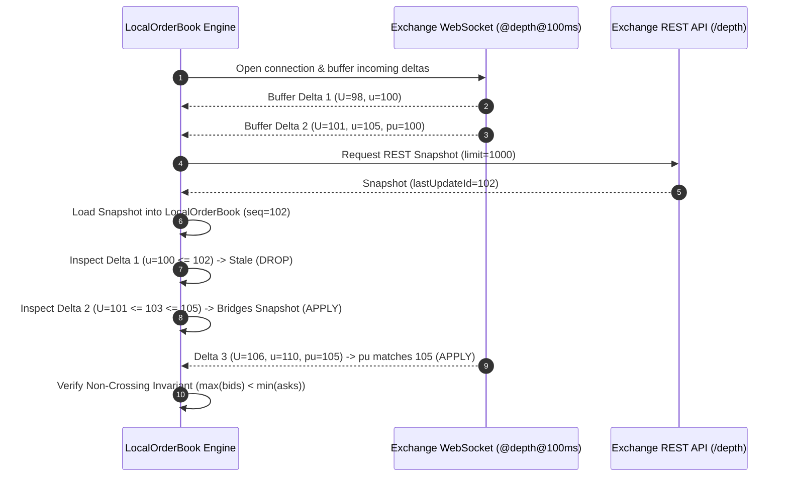

# Level-2 Limit Order Book Reconstruction & Cont's Order Flow Imbalance (OFI)

[](https://www.python.org/)
[](https://opensource.org/licenses/MIT)
[]()
[](https://github.com/psf/black)
[]()

A high-performance, sequence-safe **Level-2 Limit Order Book (LOB) Reconstruction Engine** and **Cont's Order Flow Imbalance (OFI)** quantitative feature pipeline in pure Python.

Designed for quantitative researchers, HFT practitioners, and algorithmic traders who require **mathematically rigorous microstructure features**, **zero-lookahead historical and live replay**, and **public WebSocket market data feeds** (Binance USD-M Futures & BingX Perpetual Swaps).

> **Security & IP Guarantee**: This repository contains **zero private API keys, credentials, or proprietary trading alpha strategies**. It contains solely the open mathematical formulation of Rama Cont et al. (2014) and public market-data WebSocket synchronization engines.

---

## Table of Contents

- [The Core Microstructure Problem](#the-core-microstructure-problem)
- [Key Features](#key-features)
- [Mathematical Formulation (Cont et al., 2014)](#mathematical-formulation-cont-et-al-2014)
- [Exchange Synchronization Protocol](#exchange-synchronization-protocol)
- [Project Architecture](#project-architecture)
- [Installation](#installation)
- [Quick Start](#quick-start)
  - [1. Sequence-Aware Order Book Reconstruction](#1-sequence-aware-order-book-reconstruction)
  - [2. Calculating Cont's Level-1 OFI](#2-calculating-conts-level-1-ofi)
  - [3. Multi-Level OFI (M-OFI)](#3-multi-level-ofi-m-ofi)
  - [4. Deterministic L2 Replay & Price Impact Regression](#4-deterministic-l2-replay--price-impact-regression)
  - [5. Live WebSocket Streaming (Binance & BingX)](#5-live-websocket-streaming-binance--bingx)
- [Running Unit Tests](#running-unit-tests)
- [Academic References](#academic-references)
- [License](#license)

---

## The Core Microstructure Problem

Most open-source order book scripts suffer from critical production flaws:
1. **Silent Sequence Gaps**: When WebSocket packets drop or arrive out of sequence, naive order books quietly desynchronize, creating phantom liquidity levels and corrupted signals.
2. **Crossed Book Artifacts**: Network latency can result in bid updates crossing ask updates ($P_{\text{bid}} \ge P_{\text{ask}}$), invalidating spread and microprice calculations.
3. **Confusing CVD with OFI**: Retail trading communities frequently treat Cumulative Volume Delta (CVD) as "order flow." CVD only records **executed market trades**. It is blind to limit order placements, modifications, and cancellations—which constitute over 90% of order book events.

This package provides a **fault-tolerant, sequence-checked engine** that enforces exchange-native sequence rules, prunes 0-quantity depth, validates non-crossing invariants, and computes true event-driven **Order Flow Imbalance (OFI)** as defined in academic literature.

---

## Key Features

- **Sequence-Safe LOB Engine (`LocalOrderBook`)**:
  - Full bid/ask depth ladder maintenance with $O(1)$ level updates and deletions.
  - Exchange sequence bridge check: `first_update_id <= snapshot.sequence + 1 <= last_update_id`.
  - Immediate `SequenceGapError` fail-fast on dropped or out-of-order packets.
  - Automatic crossed-book detection and zero-quantity level pruning.
- **Cont's Order Flow Imbalance (OFI)**:
  - Exact implementation of **Rama Cont, Arseniy Kukanov & Sasha Stoikov (2014)** Level-1 OFI.
  - Captures liquidity additions, cancellations, and executions across quote changes.
- **Multi-Level Order Flow Imbalance (M-OFI)**:
  - Extends OFI across arbitrary depth levels $k \in \{1, \dots, K\}$.
  - Harmonic ($1/k$) and custom-weighted integrated OFI signals for book replenishment detection.
- **Microstructure Feature Engine**:
  - Microprice (depth-weighted sub-tick price indicator) & Microprice offset in basis points.
  - Static Order Book Imbalance (OBI) at top of book and across full depth.
  - Spread in currency units and basis points ($\text{bps}$).
- **Deterministic Offline L2 Replay**:
  - Replays historical snapshots and deltas with zero lookahead bias.
  - Forward mid-price return attribution over arbitrary second horizons ($1\text{s}, 5\text{s}, 10\text{s}$) using causal `np.searchsorted`.
  - Empirical correlation and regression analytics.
- **Production Exchange Connectors (Public Endpoints Only)**:
  - **Binance USD-M Futures**: REST depth bootstrap + WebSocket `@depth@100ms` & `@trade`.
  - **BingX Perpetual Swaps**: In-band `action="all"` snapshot + `action="update"` incremental deltas with automatic gzip decompression and heartbeat management.

---

## Mathematical Formulation (Cont et al., 2014)

According to **Cont, Kukanov & Stoikov (2014)** (*The Price Impact of Order Book Events*, *Journal of Financial Econometrics*), price impact is directly driven by net order flow entering or leaving the best quotes.

Let $P_b(t)$ and $q_b(t)$ denote the best bid price and quantity, and $P_a(t)$ and $q_a(t)$ denote the best ask price and quantity at event time $t$.

### Bid-Side Event Component $e_b(t)$:
$$
e_b(t) = \begin{cases}
q_b(t), & \text{if } P_b(t) > P_b(t-1) \quad \text{(Bid price ticked up: fresh demand added)} \\
q_b(t) - q_b(t-1), & \text{if } P_b(t) = P_b(t-1) \quad \text{(Price unchanged: net size change)} \\
-q_b(t-1), & \text{if } P_b(t) < P_b(t-1) \quad \text{(Bid price ticked down: old bid consumed/cancelled)}
\end{cases}
$$

### Ask-Side Event Component $e_a(t)$:
$$
e_a(t) = \begin{cases}
-q_a(t), & \text{if } P_a(t) < P_a(t-1) \quad \text{(Ask price ticked down: sell pressure pushed ask down)} \\
q_a(t-1) - q_a(t), & \text{if } P_a(t) = P_a(t-1) \quad \text{(Price unchanged: net ask size reduction)} \\
q_a(t-1), & \text{if } P_a(t) > P_a(t-1) \quad \text{(Ask price ticked up: old ask cleared/lifted)}
\end{cases}
$$

### Net Level-1 Order Flow Imbalance (L1-OFI):
$$
\text{OFI}_1(t) = e_b(t) + e_a(t)
$$

### Contemporaneous Price Impact Relation:
Over short time intervals $\Delta t$, the mid-price change $\Delta P_{\text{mid}}(t)$ exhibits a strong linear relationship with OFI:
$$
\Delta P_{\text{mid}}(t) = \beta \cdot \text{OFI}_1(t) + \epsilon_t, \quad \beta \approx \frac{1}{\text{Depth}}
$$

---

## Exchange Synchronization Protocol

Reconstructing an incremental Level-2 book requires a precise handshake between the REST snapshot and WebSocket delta stream:



If any delta arrives with $pu \ne u_{\text{prev}}$, the engine throws `SequenceGapError`, preventing corrupted book states from polluting research or live execution.

---

## Project Architecture

```
orderbook-l2-ofi/
├── src/
│   └── orderbook_ofi/
│       ├── __init__.py           # Unified top-level package exports
│       ├── book.py               # LocalOrderBook and SequenceGapError
│       ├── models.py             # BookLevel, BookSnapshot, BookDelta, TradeEvent
│       ├── ofi.py                # Cont's L1 OFI, Multi-Level OFI, Microprice
│       ├── replay.py             # Deterministic L2 replay and causal forward returns
│       ├── storage.py            # Append-only .ndjson.gz writer and atomic JSON
│       └── collectors/
│           ├── __init__.py
│           ├── base.py           # Auto-reconnecting WebSocketCollector base class
│           ├── binance.py        # BinanceFuturesCollector (USD-M Futures public data)
│           └── bingx.py          # BingXCollector (Perpetual Swap public data)
├── examples/
│   ├── 01_orderbook_reconstruction.py   # LOB initialization, delta updates, gap checks
│   ├── 02_cont_ofi_computation.py       # Cont OFI step-by-step mathematical cases
│   ├── 03_multilevel_ofi.py             # Multi-Level OFI across top 5 depth levels
│   ├── 04_replay_and_impact_analysis.py # Deterministic replay with forward price regression
│   └── 05_live_binance_stream.py        # Real-time WebSocket LOB and live OFI stream
├── tests/
│   ├── test_models.py            # Data validation, serialization, epoch parsing
│   ├── test_book.py              # Sequence continuity, level pruning, crossed books
│   ├── test_ofi_features.py      # L1 OFI, multi-level OFI, book features
│   ├── test_replay.py            # Causal forward returns, replay stats, correlation
│   └── test_collectors.py        # URL generation, WebSocket parsing, heartbeats
├── docs/
│   ├── mathematical_formulation.md      # In-depth derivation of Cont et al. (2014)
│   └── exchange_mechanics.md            # Binance and BingX protocol specifications
├── .gitignore
├── LICENSE                       # MIT License
├── pyproject.toml                # Standard PEP 517/518 build configuration
├── requirements.txt              # Runtime dependencies
└── README.md                     # Documentation
```

---

## Installation

### Prerequisites
- Python 3.10, 3.11, or 3.12
- Standard pip environment

```bash
# Clone the repository
git clone https://github.com/your-username/orderbook-l2-ofi.git
cd orderbook-l2-ofi

# Install dependencies
pip install -r requirements.txt

# Or install in editable mode
pip install -e .
```

---

## Quick Start

### 1. Sequence-Aware Order Book Reconstruction

```python
from orderbook_ofi.book import LocalOrderBook
from orderbook_ofi.models import BookSnapshot, BookDelta

# Initialize book
book = LocalOrderBook(venue="binance", market="futures_um", symbol="BTCUSDT")

# 1. Load REST snapshot (update_id = 1000)
snapshot = BookSnapshot.from_levels(
    venue="binance", market="futures_um", symbol="BTCUSDT",
    exchange_ts=1_700_000_000_000, receive_ts_ns=1_700_000_000_050_000_000,
    bids=[[65000.0, 1.5], [64990.0, 3.0]],
    asks=[[65010.0, 1.2], [65020.0, 2.5]],
    sequence=1000,
)
book.load_snapshot(snapshot)

# 2. Apply incremental delta that bridges snapshot (u=1002)
delta = BookDelta.from_levels(
    venue="binance", market="futures_um", symbol="BTCUSDT",
    exchange_ts=1_700_000_000_100, receive_ts_ns=1_700_000_000_150_000_000,
    first_update_id=998, last_update_id=1002, previous_update_id=997,
    bids=[[65000.0, 2.5]],     # Size increased at best bid
    asks=[[65005.0, 0.8]],     # New best ask placed inside spread
)
book.apply(delta)

print(f"Best Bid: ${book.best_bid[0]:,.1f} (size: {book.best_bid[1]})")
print(f"Best Ask: ${book.best_ask[0]:,.1f} (size: {book.best_ask[1]})")
print(f"Mid Price: ${book.mid_price:,.2f} | Spread: ${book.spread:,.2f}")
```

### 2. Calculating Cont's Level-1 OFI

```python
from orderbook_ofi.models import BookSnapshot
from orderbook_ofi.ofi import compute_l1_ofi, book_snapshot_features

t0 = BookSnapshot.from_levels(
    venue="binance", market="futures_um", symbol="ETHUSDT",
    exchange_ts=1_700_000_000_000, receive_ts_ns=1_700_000_000_000_000_000,
    bids=[[3000.0, 10.0]], asks=[[3001.0, 8.0]],
)

# Best bid size increases from 10 -> 15 (+5 ETH buying pressure)
# Best ask size depleted from 8 -> 5 (+3 ETH buying pressure)
t1 = BookSnapshot.from_levels(
    venue="binance", market="futures_um", symbol="ETHUSDT",
    exchange_ts=1_700_000_000_100, receive_ts_ns=1_700_000_000_100_000_000,
    bids=[[3000.0, 15.0]], asks=[[3001.0, 5.0]],
)

ofi = compute_l1_ofi(t0, t1)
print(f"L1 OFI: {ofi:+.2f} ETH")  # Output: +8.00 ETH

features = book_snapshot_features(t1, levels=1)
print(f"Microprice: ${features['microprice']:.4f}")
print(f"Top Imbalance (OBI): {features['top_imbalance']:+.3f}")
```

### 3. Multi-Level OFI (M-OFI)

```python
from orderbook_ofi.ofi import compute_multilevel_ofi

# Evaluates order flow events across top 5 depth levels
m_ofi = compute_multilevel_ofi(previous_snapshot, current_snapshot, levels=5)

for k in range(1, 6):
    print(f"Level {k} OFI: {m_ofi[f'l{k}_ofi']:+8.2f}")

print(f"Integrated OFI: {m_ofi['integrated_ofi']:+8.2f}")
```

### 4. Deterministic L2 Replay & Price Impact Regression

```python
from orderbook_ofi.replay import replay_l2, add_forward_mid_returns, correlation_or_none

# Replay deltas against bootstrap snapshot with full sequence validation
features, stats = replay_l2(snapshot, deltas, depth=10)

# Add causal forward returns at 1-second and 5-second horizons
features = add_forward_mid_returns(features, horizons_seconds=(1, 5))

# Measure empirical correlation between OFI and forward mid-price return
corr_1s = correlation_or_none(features["l1_ofi"], features["forward_mid_return_1s"])
print(f"Corr(L1 OFI, Forward 1s Return): {corr_1s:+.4f}")
```

### 5. Live WebSocket Streaming (Binance & BingX)

```python
from orderbook_ofi.collectors.binance import BinanceFuturesCollector
from orderbook_ofi.book import LocalOrderBook
from orderbook_ofi.models import BookSnapshot, BookDelta
from orderbook_ofi.ofi import compute_l1_ofi

book = LocalOrderBook("binance", "futures_um", "BTCUSDT")
# Public websocket only - NO API KEY required
collector = BinanceFuturesCollector(symbols=["BTCUSDT"], collect_trades=True, collect_depth=True)

prev_snap = None

def on_event(event):
    global prev_snap
    if isinstance(event, BookSnapshot):
        book.load_snapshot(event)
        prev_snap = book.snapshot(event.exchange_ts_ns, event.receive_ts_ns)
    elif isinstance(event, BookDelta):
        if book.apply(event):
            curr_snap = book.snapshot(event.exchange_ts_ns, event.receive_ts_ns)
            ofi = compute_l1_ofi(prev_snap, curr_snap)
            print(f"Live OFI: {ofi:+8.3f} | Mid: ${book.mid_price:,.2f} | Spread: ${book.spread:.2f}")
            prev_snap = curr_snap

# Run streaming collection
collector.collect(on_event, duration_seconds=60.0)
```

---

## Running Unit Tests

The test suite covers event models, sequence chain bridging, zero-quantity pruning, crossed-book rejection, OFI directional cases, multi-level OFI, deterministic replay, and collector message parsers.

```bash
# Run full test suite with pytest
pytest tests -v
```

---

## Academic References

1. **Cont, R., Kukanov, A., & Stoikov, S. (2014)**. *The Price Impact of Order Book Events*. **Journal of Financial Econometrics**, 12(1), 47–88. [arXiv:1011.6402](https://arxiv.org/abs/1011.6402)
2. **Gould, M. D., Porter, M. A., Williams, S., McDonald, M., Fenn, D. J., & Howison, S. D. (2013)**. *Limit order books*. **Quantitative Finance**, 13(11), 1709–1742. [arXiv:1012.0349](https://arxiv.org/abs/1012.0349)
3. **Gould, M. D., & Bonart, J. (2016)**. *Queue imbalance as a one-tick-ahead price predictor*. **Market Microstructure and Liquidity**, 2(02), 1650006. [arXiv:1512.03492](https://arxiv.org/abs/1512.03492)
4. **Zhang, Z., Zohren, S., & Roberts, S. (2019)**. *DeepLOB: Deep convolutional neural networks for limit order books*. **IEEE Transactions on Signal Processing**, 67(11), 3001–3012. [arXiv:1808.03668](https://arxiv.org/abs/1808.03668)
5. **Xu, K., Lu, C., & Chen, J. (2020)**. *Multi-Level Order Flow Imbalance and Price Impact in High-Frequency Markets*.

---

## License

This project is licensed under the **MIT License** - see the [LICENSE](LICENSE) file for details.
Open-source and free for commercial, academic, and personal algorithmic trading use.
