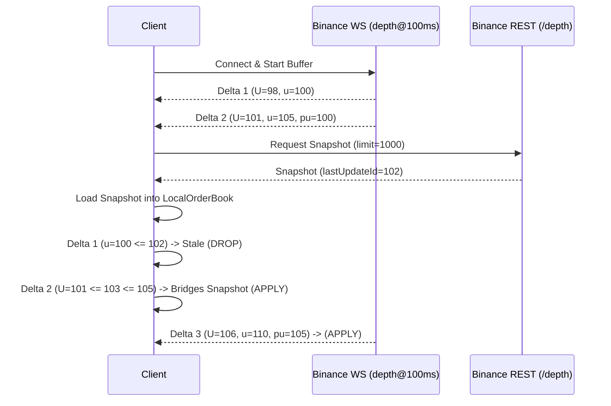

# Exchange Synchronization & LOB Reconstruction Mechanics

Building a local Level-2 order book from live exchange feeds requires handling network latency, packet loss, and asynchronous REST/WebSocket sequencing. This document details the exact protocols implemented in this package for **Binance USD-M Futures** and **BingX Perpetual Swaps**.

---

## 1. Binance USD-M Futures Protocol

### 1.1 Feeds Used
- **REST Snapshot**: `GET https://fapi.binance.com/fapi/v1/depth?symbol={symbol}&limit=1000`
- **Diff Depth WebSocket**: `wss://fstream.binance.com/stream?streams={symbol}@depth@100ms`
- **Public Trades WebSocket**: `wss://fstream.binance.com/stream?streams={symbol}@trade`

### 1.2 Synchronization Handshake

To reconstruct a local order book without dropping messages:

1. **Connect & Buffer WebSocket Stream**: Open the WebSocket connection to `@depth@100ms` and begin buffering incoming depth events into a queue.
2. **Fetch REST Snapshot**: While WebSocket events are buffering, issue a REST `GET /fapi/v1/depth` to acquire a base order book state with a `lastUpdateId`.
3. **Drop Stale Buffered Events**: Any buffered event where `last_update_id <= snapshot.lastUpdateId` is discarded.
4. **Bridge First Event**: The first event to be applied must satisfy:
   $$U \le \text{snapshot.lastUpdateId} + 1 \le u$$
   Where $U$ is `first_update_id` and $u$ is `last_update_id`.
5. **Continuous Sequence Verification**: For every subsequent delta $i$:
   - Either $pu_i = u_{i-1}$ (where $pu$ is `previous_update_id`), OR
   - $U_i = u_{i-1} + 1$.
   If this condition is violated, a **Sequence Gap** occurred (packet dropped or reordered). The local book immediately raises `SequenceGapError` and triggers a clean re-initialization.

---

## 2. BingX Perpetual Swaps Protocol

### 2.1 Feeds Used
- **Incremental Depth**: `wss://open-api-swap.bingx.com/swap-market` with subscription `{symbol}@incrDepth`
- **Public Trades**: `{symbol}@trade`

### 2.2 Rebuilding Architecture
BingX provides an in-band bootstrap mechanism:
- Upon subscribing to `@incrDepth`, the first payload sent by the server contains `action="all"`, which represents a complete book snapshot with `lastUpdateId`.
- Subsequent messages contain `action="update"` with incremental price levels.
- BingX transmits messages compressed using **gzip**; the client transparently decompresses them in real-time.
- Heartbeats: Client responds with `"Pong"` to server `"Ping"` and `{"pong": ts}` to `{"ping": ts}`.

---

## 3. Order Book Integrity Invariants

The `LocalOrderBook` enforces the following invariants at every state change:

1. **Strict Monotonicity**:
   - Bid prices must be sorted descending: $P_{b, 1} > P_{b, 2} > \dots > P_{b, N}$
   - Ask prices must be sorted ascending: $P_{a, 1} < P_{a, 2} < \dots < P_{a, N}$
2. **Non-Crossing Constraint**:
   $$P_{b, 1} < P_{a, 1}$$
   If at any point $P_{b, 1} \ge P_{a, 1}$, the book is **crossed**. In an electronic central limit order book, a crossed state signifies that updates arrived out-of-order or an exchange matching engine was briefly unhalted during an auction. The engine immediately halts replay and reports `crossed_books`.
3. **Zero Quantity Pruning**: When a price level is updated with quantity $0.0$, it is popped from the internal ladder hash map.

---

## 4. Causal Forward Returns (No Lookahead Bias)

When evaluating the predictive edge of OFI or order book features:
- In real-world trading, you receive an event at $T_{\text{receive}}$, which is strictly later than $T_{\text{exchange}}$.
- `add_forward_mid_returns` uses `np.searchsorted(timestamps, target_ns, side="left")`.
- This ensures only future ticks occurring at or after $T + \Delta t$ are referenced. If no tick exists within the observation window, `NaN` is assigned rather than extrapolating.
